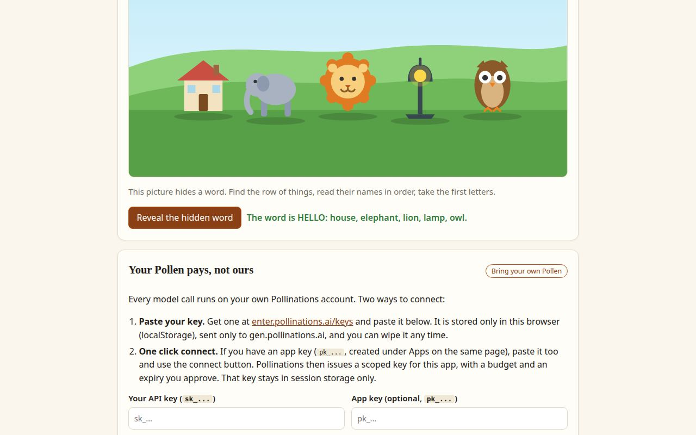

# Hide in Plain Sight

[](https://pollinations.ai/?ref=badge)

Type a secret word. A Pollinations model draws an ordinary picture that hides it. Send the picture to anyone. To read the word back, hand the picture code to a fresh model that never saw the word and ask what is hidden.

**Live app:** https://dextheking1.github.io/hide-in-plain-sight/



Built for Pollinations quest [#18367](https://github.com/pollinations/pollinations/issues/18367), after the post [How does Fable 5.1 hide messages in images?](https://www.lesswrong.com/posts/WHEQps5PK8LrrcTAb/how-does-fable-5-1-hide-messages-in-images)

## How it works

The hiding is an acrostic:

1. You type a word, say HELLO.
2. The model picks one ordinary object per letter (house, elephant, lion, lamp, owl) and draws them in a row inside a normal scene, as SVG code. No text, no letters anywhere in the picture.
3. The app checks the spelling itself: first letters of the drawn objects must match your word. If the model misses, the app shows it the mistake and asks for one redraw.
4. Reveal runs a separate, fresh model call that gets only the SVG code. It looks for the acrostic and other simple hiding places and reports what it finds.

It is a toy lock, not encryption. Anyone who suspects a hidden word and reads the initials gets it. Good for games, gifts, puzzles and quiet jokes.

## Your Pollen pays

Every model call runs on the visitor's own Pollinations account (Bring Your Own Pollen):

- Paste your own API key (`sk_...` from [enter.pollinations.ai/keys](https://enter.pollinations.ai/keys)). Stored only in the browser's localStorage, sent only to gen.pollinations.ai.
- Or connect with an app key (`pk_...`): the app runs the OAuth code flow with PKCE from the Pollinations BYOP guide, with a budget and expiry you approve. That key lives in session storage only.

No key? Tick demo mode. A tiny built-in illustrator draws simpler pictures locally, and the example picture on the page hides HELLO with no key and no Pollen at all.

Model notes: premium models (Claude Fable, Sonnet) need paid Pollen on the account. If a balance does not cover the picked model, the app says so and suggests GPT-5.4 Nano, which runs on any balance.

## Run it

Static site, no build step. Serve the folder with anything:

```bash
python3 -m http.server 8000
# open http://localhost:8000
```

Files: `index.html`, `style.css`, `app.js` (page wiring), `logic.js` (pure logic: prompts, parsing, SVG cleanup, the demo illustrator).

## Tests

```bash
node tests/logic.test.mjs
```

Covers secret cleanup, prompt building, model reply parsing, SVG sanitizing, and the full demo hide and reveal flow.

## License

MIT, see [LICENSE](LICENSE).
